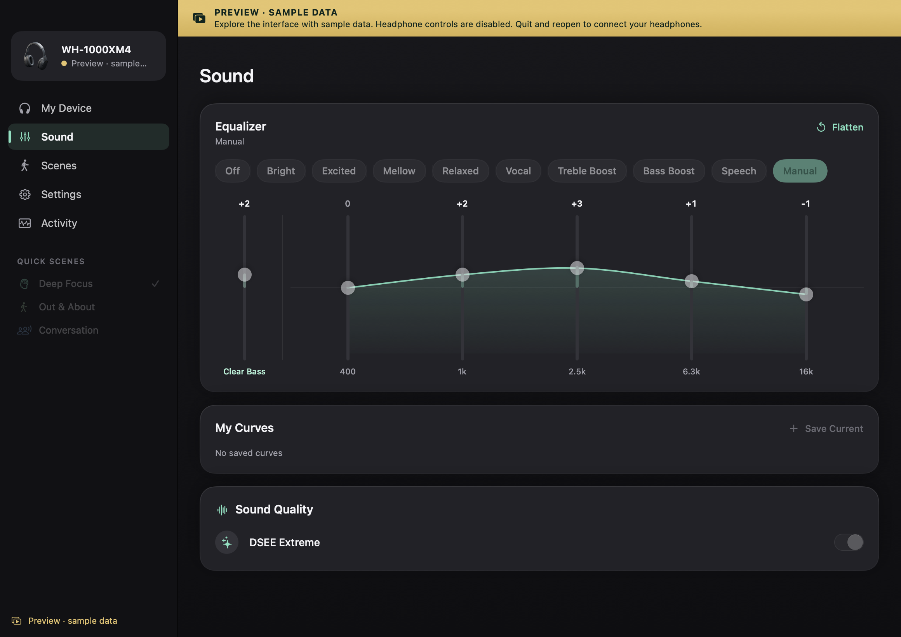

# OpenXM

**Unlock more from your Sony XM headphones.**

OpenXM brings higher-bitrate audio, firmware choice, and private headphone controls to your Mac. Free and open source.

- **Unlock LDAC and aptX HD.** Go beyond the Mac's standard AAC connection with higher-bitrate Bluetooth audio on WH-1000XM3. LDAC reaches **909 kbps at 44.1 kHz or 990 kbps at 48 kHz**; aptX HD gives you another high-quality option. Actual bitrate depends on your settings and connection. See [codec support and measured results](docs/CODEC-TRANSPORT.md).
- **Bring back the firmware you prefer.** Downgrade WH-1000XM3 to **2.0.0, before Alexa integration**, or choose from ten original firmware packages. For listeners who prefer 2.0.0's noise cancellation, OpenXM offers a way back. The international 4.5.2 → 2.0.0 downgrade has been physically verified; a noise-canceling improvement is not guaranteed. See [firmware options](docs/FIRMWARE.md) and [listener reports](https://community.sony.co.uk/t5/portable-audio/sony-wh-1000xm3-v4-1-1-firmware-failure/td-p/2564068).
- **Your headphones. Your data.** Get familiar Sony controls—noise canceling, ambient sound, EQ, device settings, and more—in a native Mac app. Optional listening history and location-triggered scenes stay on your Mac. No account, analytics, or uploads of your listening or location history.

Codec selection and firmware tools are **experimental XM3 features in current source builds**, not included in release 0.2.0. Sony app parity is still in progress; the [feature tracker](docs/SONY-APP-PARITY.md) documents remaining gaps, including 360 Reality Audio personalization and activity recognition.

[Website](https://pgerhardt.github.io/openxm/) · [Download](https://github.com/pgerhardt/openxm/releases/latest) · [Compatibility](docs/COMPATIBILITY.md) · [Contribute](CONTRIBUTING.md)

> Independent community fork of [Open Sound Connect by rolottr](https://github.com/rolottr/open-sound-connect), with its MIT license and credits preserved. Not affiliated with Sony, Apple, or the upstream distribution.



## What it does

- **Noise control:** noise canceling, wind reduction, ambient level, and Focus on Voice where the headset supports them.
- **Equalizer:** presets, a custom curve, Clear Bass, and locally saved curves. XM3/XM4 use five bands plus bass.
- **Find Your Equalizer (unreleased, WH-1000XM3):** guided listening comparisons for sound balance, bass and detail, with original/result comparison and a verified Custom 2 save. Cancel restores the original EQ bank; interrupted sessions retain a local recovery file. Uses independently designed comparisons, without starting playback or changing volume.
- **Sound and device settings:** DSEE, Speak-to-Chat (XM4), wearing detection, automatic power off, and other reported capabilities.
- **Audio connection:** a live My Device card shows the headphone-reported music codec, Mac output sample rate/channels and headphone microphone activity. Automatic mode uses read-only route checks. An unreleased, opt-in XM3 codec selector adds SBC, AAC, aptX, aptX HD and LDAC through a separate experimental transmitter and virtual audio driver, with live media bitrate and encoder-target readings. All five codecs, Sony control coexistence and return to native AAC have been checked on one XM3. See [codec transport](docs/CODEC-TRANSPORT.md) for evidence and remaining limitations.
- **Scenes:** save combinations of settings and apply them manually, on connection, on a schedule, or on app activation. Unreleased place triggers add arrival/departure with explicit location permission and stable boundary detection; see [location scenes](docs/LOCATION-SCENES.md).
- **Legacy XM3 settings (unreleased):** device-supplied NC/AMBIENT button choices, Surround/VPT and Sound Position Control. Protocol tests pass; hardware write validation is pending. Sound effects also work with scenes.
- **Listening history (unreleased):** opt-in daily playback-time estimates, separate opt-in session times, history charts, model/date filters and a browsable usage log. Preserves legacy totals and recorded time zones, with session-aware backup merging. A separate, default-off song-history option saves available titles, artists, albums, sources and intervals, with search and source filters. Mac metadata requires a matching player audio route; unknown sources leave gaps. No cloud sync. See [recording and retention](docs/LISTENING-HISTORY.md).
- **App-data backup (unreleased):** export scenes, saved places and listening history while offline. Review and merge selected data, keep imported automatic triggers disabled, and preserve recording/location preferences. Original files are retained for recovery; repeat imports do not add overlapping daily listening totals. Files use OpenXM's own format, without Sony cloud interoperability.
- **Settings backup (unreleased):** save readable settings, the reported V1 voice-language selection and the active EQ curve, optionally including all custom EQ slots on V1 headphones and standard customizable V2 EQ. Preview compatibility and restore selected values with read-back, preset-switch persistence and reconnect checks. Collecting inactive curves briefly selects each preset and restores the original selection. A saved language opens a separate package review; ordinary settings restoration never uploads a language package. Downloaded voice packages can be exported and reopened separately with their original metadata, notices and provenance. Hidden ambient preferences, calibration and Sony account sync remain incomplete; physical restoration is not yet verified.
- **Menu bar:** quick controls, battery, EQ, and scenes without leaving your current app.
- **Voice language (unreleased):** display V1 installed/supported languages and check/download original packages using a fresh international XM3 service mapping. Show Sony's localized preparation instructions and integrity-checked notice; preserve original package/notice bytes, metadata, hashes and provenance. A read-only preparation check rereads the headset, enforces its update method and battery threshold, and revalidates saved files. An experimental install/resume flow adds final confirmation, a separate session journal and post-install language verification. Live XM3 package and installation validation remain pending. See [protocol evidence](docs/VOICE-GUIDANCE.md).
- **Headphone firmware (unreleased, experimental):** check regional Sony metadata and select from ten pinned international, Japanese and Chinese XM3 packages, then install or resume from Settings. Upgrades, downgrades and region changes are experimental; only international 4.5.2 → 2.0.0 has a physical installation result.
- **Mac integration:** keyboard shortcuts, reconnection, optional launch at login, and local Now Playing controls.
- **Audio recovery (unreleased):** unexpected custom-codec audio loss pauses a verified active media player before restoring an available output. Codec switches remain quiet. If pause cannot be confirmed, use Restore audio anyway or choose an output; reconnecting never automatically starts playback. Physical disconnect/pause validation is pending.
- **Saved codec (unreleased):** the preferred codec is remembered per headphone and restored once after launch when those headphones connect. Choosing Automatic saves that choice; quitting or losing the connection preserves the preference. Sample-rate and LDAC settings also persist.
- **Honest feedback:** setting read-back where supported and Activity entries for confirmed, adjusted, failed, or unconfirmed changes.

The native app talks to the headset; the website's interactive controls are an illustrative preview. An [experimental Mac-only firmware tool](docs/FIRMWARE.md) has completed an international WH-1000XM3 downgrade from 4.5.2 to 2.0.0, including restart, completion and independent version read-back. The tool also implements transitions among ten original international, Japanese and Chinese packages, with explicit cross-region warnings and regional read-back. Those other paths have automated coverage but await physical installation tests. Other models and unlisted firmware remain unsupported. The separate experimental codec transport does not modify headphone firmware or add codecs to Apple's system Bluetooth stack.

## Install

Requires **macOS 15+**, Apple silicon or Intel, and compatible headphones paired in System Settings → Bluetooth.

1. Download the ZIP matching your Mac from [Releases](https://github.com/pgerhardt/openxm/releases/latest): `arm64` for Apple silicon or `x86_64` for Intel.
2. Unzip it and move **OpenXM.app** into Applications.
3. Connect the headphones in macOS Bluetooth settings, open OpenXM, and allow Bluetooth access.

Community builds are **ad-hoc signed, not Apple notarized**. macOS may block a downloaded app. Building locally is the supported alternative; do not disable system security settings. Developer ID signing requires a maintainer's own Apple credentials, which are not included.

## Build from source

Install Xcode or the Xcode Command Line Tools (`xcode-select --install`), then:

```sh
git clone https://github.com/pgerhardt/openxm.git
cd openxm
./scripts/build.sh
open build/OpenXM.app
```

No third-party Swift packages or build-time downloads. Swift 6+, SwiftPM, Apple system frameworks, and a small BSD-licensed vendored media helper. The build script makes the bundle, draws the icon, includes licenses, and ad-hoc signs it. Launch the `.app`, rather than the executable inside it, so Bluetooth permission belongs to the app.

```sh
./scripts/test.sh                  # Protocol, state, preview, playback, updates
./scripts/package.sh               # Architecture-specific ZIP + SHA-256
./scripts/install.sh               # Install to ~/Applications and launch
CONFIG=debug ./scripts/build.sh    # Debug bundle
```

`SDKROOT` can override the selected SDK. The scripts never change `xcode-select` globally. Open `Package.swift` in Xcode for editing.

### Explore without headphones

```sh
open -n build/OpenXM.app --args --demo
```

The persistent **PREVIEW · SAMPLE DATA** banner identifies the built-in sample. Headphone writes, media controls, and scene automation are disabled. Quit and reopen normally to connect. Local scene and preference edits still save to your Mac.

### Run the website

```sh
python3 -m http.server 4173 --directory website/dist
```

Open `http://localhost:4173`. The website is buildless HTML/CSS/JavaScript, with no framework, external fonts, trackers, or runtime dependencies. `python3 scripts/check-website.py` validates internal links and assets; `node --check website/dist/app.js` checks JavaScript syntax.

GitHub Pages publishes `website/dist` on pushes to `main`. A separate private Sites deployment can be used for preview; its manifest is under `website/.openai/`.

## Compatibility

| Model | This project's status |
| --- | --- |
| **WH-1000XM4** | Primary target. The upstream project reports hardware-tested V1 controls on firmware 2.6.0; this fork needs its own hardware pass. |
| **WH-1000XM3** | Core controls tested on firmware 4.5.2: noise modes, EQ, DSEE HX, touch panel, voice guidance, auto-off settings, and scenes. Requires the local Off-to-active noise fix, not yet in release 0.2.0. See the [hardware evaluation](docs/XM3-HARDWARE-EVALUATION.md) for exact coverage and limitations. |
| **WH-1000XM5 / XM6** | Experimental inherited V2 implementation; not hardware verified here. |
| Other Sony models | No compatibility promise. Controls appear only for reported capabilities. |

Tests and a successful build do **not** establish physical-headphone compatibility. See [the hardware checklist](docs/COMPATIBILITY.md) before reporting a model as verified. XM3 has no Speak-to-Chat. Model and firmware differences matter.

## Keyboard shortcuts

| Shortcut | Action |
| --- | --- |
| ⌘1–⌘5 | My Device, Sound, Scenes, Settings, Activity |
| ⌘K / ⇧⌘K | Connect / disconnect controls |
| ⌘R | Refresh status |
| ⌃⌘1–⌃⌘9 | Apply a scene |
| ⌘, | Preferences |

Closing the window keeps OpenXM in the menu bar when enabled. Use ⌘Q or Quit to stop it and its automations.

## Privacy

Headphone communication is local Bluetooth. Scenes live in `~/Library/Application Support/SoundConnect/scenes.json`; preferences use the separate `io.github.pgerhardt.SoundConnect` defaults domain. The storage names are internal identifiers from early development. This fork does not overwrite the original upstream app's preferences or scenes.

Update checks are **off by default**. If enabled, the app reads the public GitHub Releases API for `pgerhardt/openxm` at most daily, without sending headphone data. Manual update checks use the same endpoint. No automatic download or installation occurs.

Headphone firmware checks and downloads are separate, explicit actions. They read Sony's public metadata and packages for the selected XM3 region, or the pinned MDR Proxy GitHub archive for international 2.0.0, without sending device identifiers or credentials. Verified packages are cached under `~/Library/Application Support/SoundConnect/Firmware`. Installation requires a further confirmation and live device checks.

Now Playing reads local macOS metadata with the bundled MediaRemote Adapter. Track details are saved only when the separate song-history option is enabled; daily/session history does not enable it. The helper uses a private macOS interface and may break after OS updates. Diagnostics can contain Bluetooth addresses and media metadata: redact before sharing.

## Troubleshooting

- Connect the headphones to macOS first; audio and the app's RFCOMM control connection are separate.
- If Bluetooth was denied, enable OpenXM in System Settings → Privacy & Security → Bluetooth, then reopen.
- Close other headphone control apps if the control channel is busy.
- Check Activity when a setting is unavailable or a write fails. Do not interpret an unconfirmed change as success.
- Use a read-only report when filing a hardware issue:

```sh
open -n -W build/OpenXM.app --args --probe --out "$HOME/Desktop/openxm-probe.txt"
```

Close the regular instance first. Replay a report locally with `--replay /absolute/path/to/report.txt`; the replay banner clearly marks it as non-live. Do not post an unredacted report.

## Open-source foundation

This project is built on the substantial work in [Open Sound Connect](https://github.com/rolottr/open-sound-connect). [SonyBridge](https://github.com/AmitRajput-Dev/SonyBridge) and [Sony Device Center](https://github.com/marconvcm/sony-device-center) informed the protocol review and regression fixtures. The app is native Swift/SwiftUI using IOBluetooth; the website is plain web technology. Blender sources for the headphone illustration are included.

See [THIRD_PARTY_NOTICES.md](THIRD_PARTY_NOTICES.md) for exact upstream revisions, authors, modifications, and licenses. Released under [MIT](LICENSE); the media helper retains its BSD-3-Clause license.
