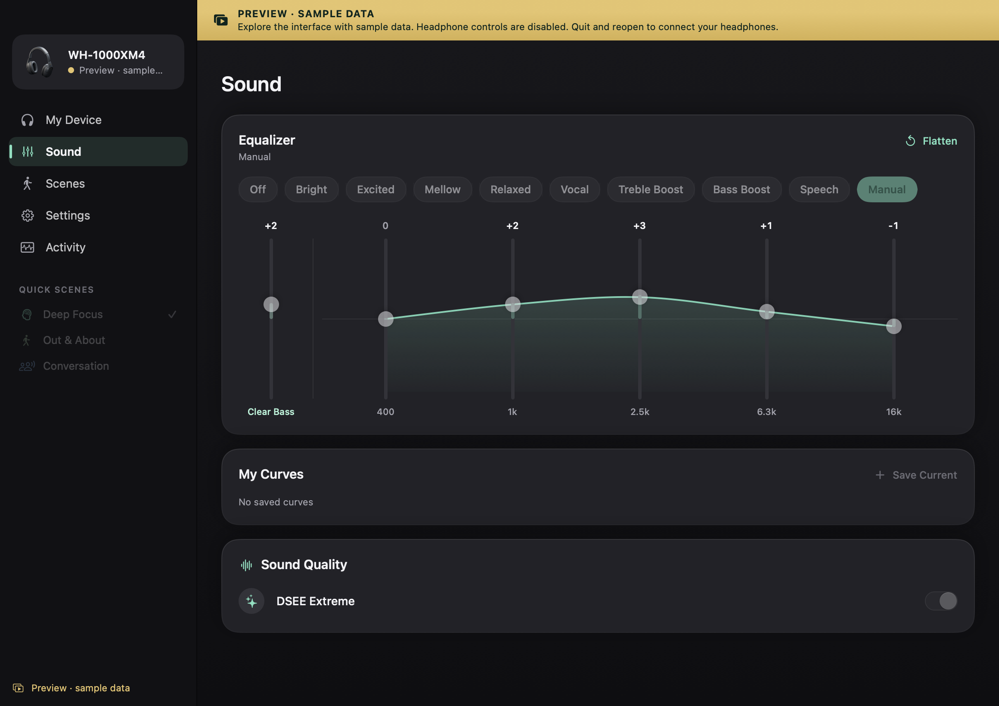

# OpenXM

**Control Sony XM headphones from your Mac. Free and open source.**

A native SwiftUI app with local Bluetooth control, noise canceling, ambient sound, EQ, saved scenes, and a compact menu bar. No account, activation, analytics, or paid feature unlocks.

[Website](https://pgerhardt.github.io/openxm/) · [Download](https://github.com/pgerhardt/openxm/releases/latest) · [Compatibility](docs/COMPATIBILITY.md) · [Contribute](CONTRIBUTING.md)

> Independent community fork of [Open Sound Connect by rolottr](https://github.com/rolottr/open-sound-connect), with its MIT license and credits preserved. Not affiliated with Sony, Apple, or the upstream distribution.



## What it does

- **Noise control:** noise canceling, wind reduction, ambient level, and Focus on Voice where the headset supports them.
- **Equalizer:** presets, a custom curve, Clear Bass, and locally saved curves. XM3/XM4 use five bands plus bass.
- **Sound and device settings:** DSEE, codec display, Speak-to-Chat (XM4), wearing detection, automatic power off, and other reported capabilities.
- **Scenes:** save combinations of settings and apply them manually, on connection, on a schedule, or on app activation.
- **Menu bar:** quick controls, battery, EQ, and scenes without leaving your current app.
- **Mac integration:** keyboard shortcuts, reconnection, optional launch at login, and local Now Playing controls.
- **Honest feedback:** setting read-back where supported and Activity entries for confirmed, adjusted, failed, or unconfirmed changes.

The native app talks to the headset; the website's interactive controls are an illustrative preview. No firmware updater or additional macOS codecs are included.

## Install

Requires **macOS 15+**, Apple silicon or Intel, and compatible headphones paired in System Settings → Bluetooth.

1. Download the ZIP matching your Mac from [Releases](https://github.com/pgerhardt/openxm/releases/latest): `arm64` for Apple silicon or `x86_64` for Intel.
2. Unzip it and move **OpenXM.app** into Applications.
3. Connect the headphones in macOS Bluetooth settings, open OpenXM, and allow Bluetooth access.

Community builds are **ad-hoc signed, not Apple notarized**. macOS may block a downloaded app. Building locally is the supported alternative; do not disable system security settings. Developer ID signing requires a maintainer's own Apple credentials, which are not included.

## Build from source

Install Xcode or the Xcode Command Line Tools (`xcode-select --install`), then:

```sh
git clone https://github.com/pgerhardt/openxm.git
cd openxm
./scripts/build.sh
open build/OpenXM.app
```

No third-party Swift packages or build-time downloads. Swift 6+, SwiftPM, Apple system frameworks, and a small BSD-licensed vendored media helper. The build script makes the bundle, draws the icon, includes licenses, and ad-hoc signs it. Launch the `.app`, rather than the executable inside it, so Bluetooth permission belongs to the app.

```sh
./scripts/test.sh                  # Protocol, state, preview, playback, updates
./scripts/package.sh               # Architecture-specific ZIP + SHA-256
./scripts/install.sh               # Install to ~/Applications and launch
CONFIG=debug ./scripts/build.sh    # Debug bundle
```

`SDKROOT` can override the selected SDK. The scripts never change `xcode-select` globally. Open `Package.swift` in Xcode for editing.

### Explore without headphones

```sh
open -n build/OpenXM.app --args --demo
```

The persistent **PREVIEW · SAMPLE DATA** banner identifies the built-in sample. Headphone writes, media controls, and scene automation are disabled. Quit and reopen normally to connect. Local scene and preference edits still save to your Mac.

### Run the website

```sh
python3 -m http.server 4173 --directory website/dist
```

Open `http://localhost:4173`. The website is buildless HTML/CSS/JavaScript, with no framework, external fonts, trackers, or runtime dependencies. `python3 scripts/check-website.py` validates internal links and assets; `node --check website/dist/app.js` checks JavaScript syntax.

GitHub Pages publishes `website/dist` on pushes to `main`. A separate private Sites deployment can be used for preview; its manifest is under `website/.openai/`.

## Compatibility

| Model | This project's status |
| --- | --- |
| **WH-1000XM4** | Primary target. The upstream project reports hardware-tested V1 controls on firmware 2.6.0; this fork needs its own hardware pass. |
| **WH-1000XM3** | V1 target. Shared protocol and capability-driven controls; packet parsing is regression-tested, actual headphone operation is not yet verified in this fork. |
| **WH-1000XM5 / XM6** | Experimental inherited V2 implementation; not hardware verified here. |
| Other Sony models | No compatibility promise. Controls appear only for reported capabilities. |

Tests and a successful build do **not** establish physical-headphone compatibility. See [the hardware checklist](docs/COMPATIBILITY.md) before reporting a model as verified. XM3 has no Speak-to-Chat. Model and firmware differences matter.

## Keyboard shortcuts

| Shortcut | Action |
| --- | --- |
| ⌘1–⌘5 | My Device, Sound, Scenes, Settings, Activity |
| ⌘K / ⇧⌘K | Connect / disconnect controls |
| ⌘R | Refresh status |
| ⌃⌘1–⌃⌘9 | Apply a scene |
| ⌘, | Preferences |

Closing the window keeps OpenXM in the menu bar when enabled. Use ⌘Q or Quit to stop it and its automations.

## Privacy

Headphone communication is local Bluetooth. Scenes live in `~/Library/Application Support/SoundConnect/scenes.json`; preferences use the separate `io.github.pgerhardt.SoundConnect` defaults domain. The storage names are internal identifiers from early development. This fork does not overwrite the original upstream app's preferences or scenes.

Update checks are **off by default**. If enabled, the app reads the public GitHub Releases API for `pgerhardt/openxm` at most daily, without sending headphone data. Manual update checks use the same endpoint. No automatic download or installation occurs.

Now Playing reads local macOS metadata with the bundled MediaRemote Adapter; it stores no listening history. The helper uses a private macOS interface and may break after OS updates. Diagnostics can contain Bluetooth addresses and media metadata: redact before sharing.

## Troubleshooting

- Connect the headphones to macOS first; audio and the app's RFCOMM control connection are separate.
- If Bluetooth was denied, enable OpenXM in System Settings → Privacy & Security → Bluetooth, then reopen.
- Close other headphone control apps if the control channel is busy.
- Check Activity when a setting is unavailable or a write fails. Do not interpret an unconfirmed change as success.
- Use a read-only report when filing a hardware issue:

```sh
open -n -W build/OpenXM.app --args --probe --out "$HOME/Desktop/openxm-probe.txt"
```

Close the regular instance first. Replay a report locally with `--replay /absolute/path/to/report.txt`; the replay banner clearly marks it as non-live. Do not post an unredacted report.

## Open-source foundation

This project is built on the substantial work in [Open Sound Connect](https://github.com/rolottr/open-sound-connect). [SonyBridge](https://github.com/AmitRajput-Dev/SonyBridge) and [Sony Device Center](https://github.com/marconvcm/sony-device-center) informed the protocol review and regression fixtures. The app is native Swift/SwiftUI using IOBluetooth; the website is plain web technology. Blender sources for the headphone illustration are included.

See [THIRD_PARTY_NOTICES.md](THIRD_PARTY_NOTICES.md) for exact upstream revisions, authors, modifications, and licenses. Released under [MIT](LICENSE); the media helper retains its BSD-3-Clause license.
